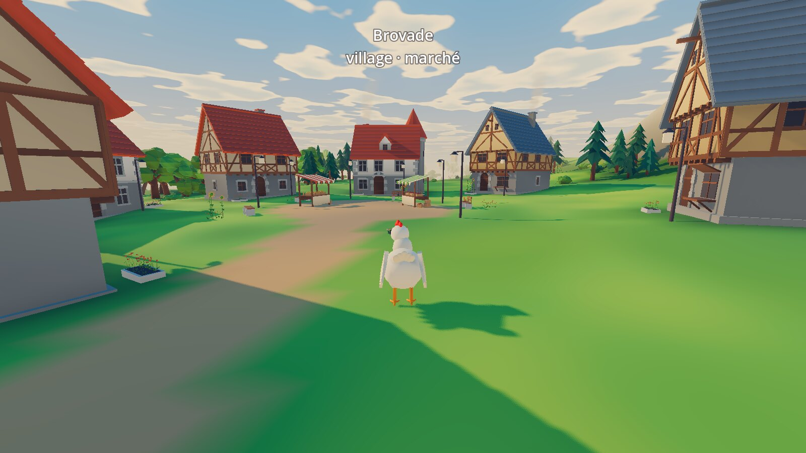

# OpenWorld

Un monde ouvert en 3D, sans fin, où l'on incarne une poule. Il est fait avec Godot 4.7 en GDScript.

**[Jouer dans le navigateur](https://tdebarochez.github.io/openworld/)** : la version web est reconstruite et republiée à chaque push sur `main`.



Le monde se génère au fil des déplacements : prairies, forêts, lacs et montagnes, villages reliés par des routes, et repères visibles de loin. Il vit au rythme des heures, des saisons et de la météo. Tout ce qui le compose est généré par du code : le terrain, les modèles 3D et les sons. Le projet ne contient aucun asset fait à la main.

## Ce qu'on y trouve

- **Le monde** : il est découpé en zones de 128 m, construites autour du joueur. Sur ordinateur, elles sont construites en arrière-plan. Leur détail diminue avec la distance, et la portée de vue va jusqu'à 2 km.
- **Les paysages** : prairies, forêts de trois essences, bosquets en lisière, lacs, montagnes enneigées en hiver et fleurs.
- **Les villages** : chacun a un nom et une particularité (puits, fontaine ou marché). On y trouve :
  - des maisons médiévales et des chalets, des lampadaires, des bancs et des bacs à fleurs ;
  - des chats sur les bancs ;
  - de la fumée aux cheminées, des fenêtres qui s'allument le soir et du linge qui sèche ;
  - des forges, et des moutons et des vaches dans les prés autour.
- **Les repères** : tours en ruine, moulins à vent, ponts de pierre, chapelles et menhirs. Des cabanes de pêcheur avec leur ponton bordent les lacs.
- **Les feux de camp** : dans des clairières en forêt, loin des villages. On les repère à leur fumée le jour et à leur lueur la nuit, et on les entend crépiter.
- **Le temps** :
  - un cycle jour/nuit, avec la Voie lactée ;
  - quatre saisons, avec chacune sa musique ;
  - des nuages répartis en trois couches, de la pluie, de la neige et des orages ;
  - de la brume au fond des vallées le matin.
- **La poule** : elle marche, court, nage, bat des ailes en l'air et plane.
- **Les vues** : première personne, troisième personne et vue isométrique. Une carte montre la région autour du joueur.

## Commandes

Touches par défaut. Elles se changent dans le menu pause (Échap), qui les garde pour les parties suivantes.

| Touche | Action |
|---|---|
| ZQSD / WASD | Se déplacer (touches physiques, donc ZQSD sur un clavier AZERTY) |
| Maj | Courir |
| Espace | Sauter. En l'air : battre des ailes, jusqu'à 3 fois. Dans l'eau : remonter |
| Clic gauche maintenu en l'air | Planer. Commandes inversées comme un manche d'avion : souris vers le bas, cabrer (on remonte en perdant de la vitesse, jusqu'au décrochage) ; vers le haut, piquer (on accélère en perdant de l'altitude) |
| Souris | Regarder autour de soi |
| C | Changer de vue : première personne, troisième personne, isométrique |
| M | Carte |
| 1 à 4 | Saison |
| + / - | Avancer ou reculer l'heure |
| O / Maj+O | Plus ou moins d'objets |
| P / Maj+P | Portée de vue plus ou moins grande |
| N / Maj+N | Météo |
| L | Licences |
| Échap | Menu pause : reprendre, configuration des touches, licences, afficher ou masquer l'overlay d'infos (zones, saison, heure, objets, portée, météo). Le jeu est en pause tant qu'il est ouvert |

## Lancer le jeu

Il faut [Godot 4.7](https://godotengine.org).

1. Lancer le jeu depuis la racine du dépôt :

   ```bash
   godot --path .
   ```

   On peut aussi ouvrir `project.godot` dans l'éditeur et appuyer sur F5.

2. Pour la version web, créer d'abord le dossier de sortie :

   ```bash
   mkdir -p build/web
   ```

3. Exporter la version web. Elle utilise le moteur de rendu « Compatibility » (WebGL 2), plus léger que celui de l'ordinateur :

   ```bash
   godot --headless --path . --export-release "Web" build/web/index.html
   ```

4. Servir le dossier en local :

   ```bash
   python3 -m http.server 8060 -d build/web
   ```

5. Ouvrir http://localhost:8060.

## Tests

Chaque test est un script autonome qui affiche une ligne `… OK` en cas de succès.

1. Importer les assets, une fois :

   ```bash
   godot --headless --path . --import
   ```

2. Lancer un test, par exemple :

   ```bash
   godot --headless --path . -s tests/test_world.gd
   ```

3. Ou les lancer tous :

   ```bash
   for t in tests/test_*.gd; do godot --headless --path . -s "$t"; done
   ```

## Générer les assets

Les modèles 3D sont produits par des scripts Blender déterministes : les relancer redonne exactement les mêmes fichiers. Toutes les couleurs viennent d'une palette commune, `assets/palette.json`.

1. Régénérer un modèle (ici les maisons) :

   ```bash
   /Applications/Blender.app/Contents/MacOS/Blender --background --python tools/make_houses.py
   ```

2. Régénérer les sons et les musiques (il faut `numpy`) :

   ```bash
   python3 tools/make_sounds.py
   ```

3. Régénérer les chants d'oiseaux :

   ```bash
   python3 tools/make_chirps.py
   ```

4. Réimporter ensuite les assets dans Godot :

   ```bash
   godot --headless --path . --import
   ```

## Organisation

| Fichier | Rôle |
|---|---|
| `world.gd` | Zones, terrain, villages, routes, cabanes, repères, interface |
| `player.gd` | Déplacements, battements d'ailes, vol plané, caméras |
| `hen.gd` | Animations de la poule |
| `daynight.gd` | Heure du jour, soleil, lune, ciel, étoiles, étalonnage des couleurs |
| `seasons.gd` | Saisons : couleurs, feuillage, neige, fleurs |
| `weather.gd` | Météo, pluie, neige, orages |
| `clouds.gd` | Nuages |
| `life.gd` | Vie des villages : fumée, fenêtres, linge, forges, troupeaux |
| `ambience.gd` | Sons d'ambiance selon le lieu |
| `birds.gd` | Oiseaux |
| `audio.gd` | Musique et sons du joueur |
| `map.gd` | Carte |
| `menu.gd` | Menu pause, configuration des touches, réglages sauvegardés |
| `credits.gd` | Écran des licences |
| `tools/` | Scripts de génération des modèles et des sons |
| `tests/` | Tests |
| `assets/` | Modèles, sons et palette générés |

## Licences

Le code, les scripts de génération et les assets générés de ce dépôt sont sous licence MIT : voir [LICENSE](LICENSE).

Le moteur Godot est aussi distribué sous licence MIT. Le jeu affiche sa notice de licence, et celles des composants qu'il embarque, avec la touche L ou depuis le menu pause.
